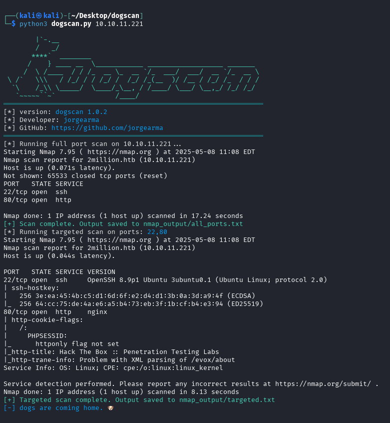
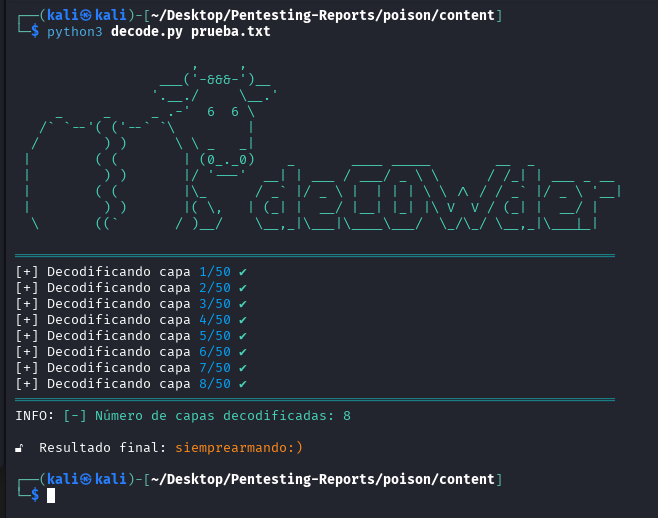

# Offensive Security Toolkit

Small Python tools I built and use during my own pentesting practice (HTB, Proving Grounds, OSCP prep).
Each one automates a step I was repeating by hand, so I could spend the time on analysis instead of typing.

> ⚠️ For authorized targets only (labs, CTFs, systems you own or have written permission to test).

## Tools

| Tool | What it does | When I use it |
|---|---|---|
| [**dogscan**](dogscan/) | Nmap wrapper with service-specific enumeration modules (FTP, SSH, SMB) and SearchSploit lookups | First 10 minutes on a new box |
| [**decowder**](decowder/) | Decodes nested Base64 layer by layer until it stops being valid Base64 | Obfuscated strings, creds or configs found on a target |
| [**mks**](mks/) | Creates a ready-to-use workspace for a new machine: report template, enumeration notes, exploits folder | Before starting any machine |

All three are standard-library Python, so there's nothing to `pip install`.

---

## dogscan: service-aware enumeration



dogscan doesn't replace Nmap. It chains the scans I always run and adds the follow-up checks for each service:

1. **Full TCP port discovery**, then a targeted `-sC -sV` scan only on the open ports
2. **OS detection**
3. **Per-service modules**
   - **FTP**: anonymous login, default creds, known backdoors (vsftpd 2.3.4, ProFTPD), auto-download of accessible files
   - **SSH**: algorithms and host keys, auth method info leaks, non-intrusive user enumeration
   - **SMB**: null-session share listing, READ/WRITE access checks, user enumeration via `rpcclient`, MS17-010 / Samba usermap heuristics
4. **Vulnerability scripts** (`vuln`, `vulners`) plus **SearchSploit** lookups on the detected service banners

```bash
./dogscan.py 10.10.10.10 --mode deep     # fast | medium | deep (default)
```

| Mode | Runs |
|---|---|
| `fast` | Port discovery + OS detection |
| `medium` | + targeted `-sC -sV` scan |
| `deep` | + vuln scripts + service modules |

Results are saved in `nmap_output/`, with one subfolder per service, so they're easy to paste into a report.

**Requires:** `nmap`. Optional: `searchsploit`, `smbclient`, `rpcclient`, `ftp`, `openssl`. All come with Kali.

---

## decowder: multi-layer Base64 decoder



```bash
python3 decowder.py blob.txt                 # print the result
python3 decowder.py blob.txt -o out.txt      # save to a file
python3 decowder.py blob.txt -m 20 -v        # cap at 20 layers, verbose
```

Before decoding each layer it validates strictly (regex plus `b64decode(validate=True)`), so it stops at the real payload instead of turning it into garbage. It also has an iteration cap so it can't loop forever.

---

## mks: machine workspace generator

```bash
python3 mks.py Forest
```

Creates `Forest/` with a Markdown report template, an `enum.txt` for enumeration notes, an `exploits/` folder and a `screenshots/` folder. Every machine ends up with the same structure, which makes the write-up much quicker.

---

## Why these exist

During OSCP prep I noticed I was doing the same things on every machine: the same three Nmap passes, the same anonymous FTP and null-session SMB checks, the same CyberChef "From Base64" ×5. These tools are those habits turned into code.
The methodology comes first: I learned each step manually before automating it.

## Author

**Jorge Armando Escobar**, junior pentester (OSCP / CRTP in progress)
[Portfolio](https://jorgearmandoescobar.com) · [Hack The Box](https://app.hackthebox.com/jorgearma/1449173)
